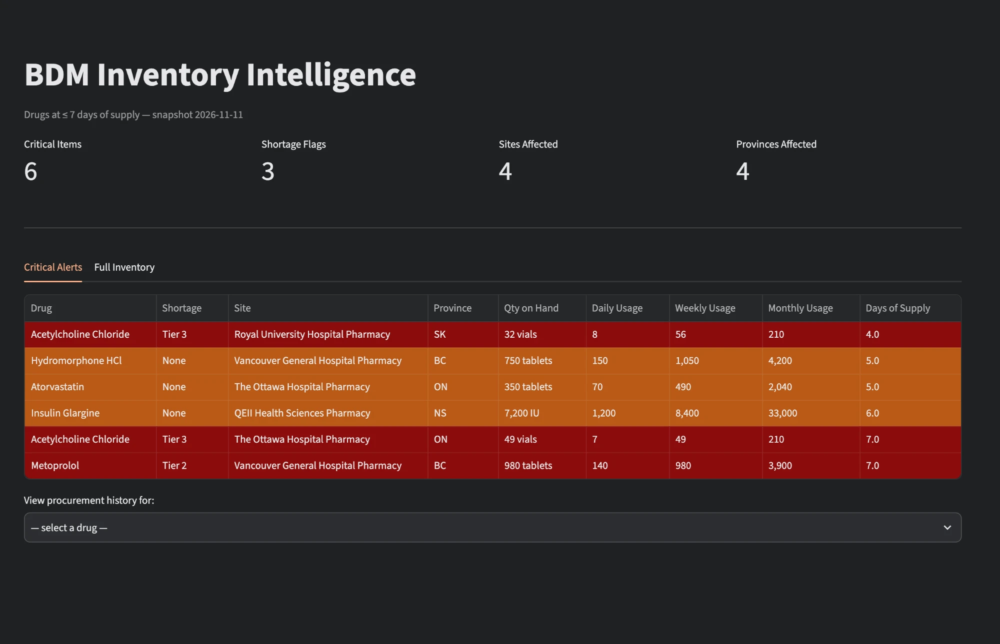
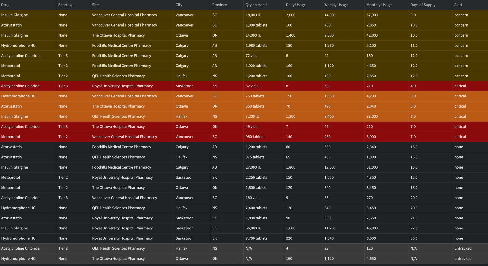
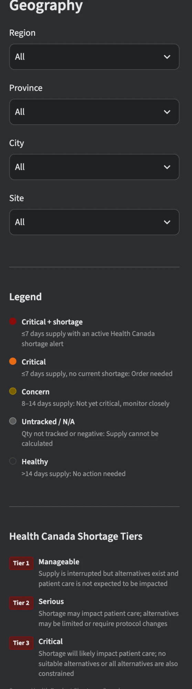
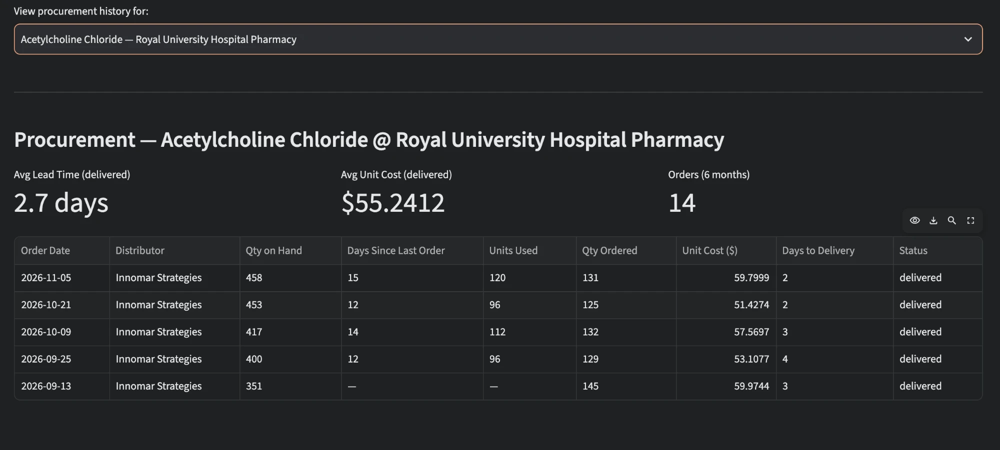

# BDM Inventory Intelligence

A web-based inventory decision-support tool that answers one question: **which drugs, at which sites, have seven days of supply or less?**

Built with Streamlit and SQLite. Designed for hospital pharmacy environments where supply disruptions carry direct patient-care risk.

[Live App](https://bdm-inventory-intelligence-cz7r5peqw3kpppnxxb976j.streamlit.app/)

---

## What It Does

- Flags drugs at critical supply levels (7 days or less) across multiple hospital sites
- Surfaces active Health Canada drug shortages alongside inventory alerts
- Shows procurement history per drug-site pair with derived consumption metrics
- Filters by region, province, city, or individual site
- Displays a full inventory view across all alert levels

---

## Features

### Critical Alerts



The primary view. Every drug-site pair at 7 days of supply or less is surfaced here, sorted by days remaining. Each row is color-coded: maroon for items that also carry an active Health Canada shortage alert, orange for critical items with no current shortage. The Shortage column shows the tier (Tier 1, 2, or 3) or None. Summary tiles at the top show total critical items, active shortage flags, sites affected, and provinces affected — all driven by the current geography filter.

---

### Full Inventory



A complete view of all 25 drug-site combinations across all alert states. Rows are color-coded by alert level: maroon (critical + shortage), orange (critical), amber (concern, 8–14 days), grey (untracked or negative quantity), and no fill for healthy stock (greater than 14 days). This tab lets a pharmacist confirm the full picture — not just what is urgent, but what is trending toward critical and what is comfortable.

---

### Geography Filters and Legends



The sidebar provides cascading geography filters — Region, Province, City, Site — that narrow both tabs simultaneously. Each level updates based on the selection above it, so the options always reflect what is actually in scope. Below the filters, two reference legends are always visible: the alert level legend explaining what each row color means operationally, and the Health Canada Shortage Tiers legend defining Tier 1 (Manageable), Tier 2 (Serious), and Tier 3 (Critical) with plain-language descriptions sourced from Health Canada classifications.

---

### Procurement History



Selecting any drug-site pair from the Critical Alerts tab opens a procurement history panel. It shows the five most recent orders with order date, distributor, quantity on hand at the time of order, days since the previous order, units consumed between orders, quantity ordered, unit cost, days to delivery, and status. Three summary metrics at the top show average lead time (delivered orders only), average unit cost, and total orders over the past six months. Units consumed is a derived field calculated from consecutive order records rather than direct dispensing logs.

---

## Running Locally

**Requirements:** Python 3.10+

```bash
pip install -r requirements.txt
streamlit run app.py
```

The database is created automatically on first run. No setup required.

---

## Tech Stack

| Layer | Tool |
|---|---|
| UI | Streamlit |
| Database | SQLite |
| Data | Pandas |
| Seed data | Python (data/seed.py) |

---

## Data

All inventory quantities, purchase order history, usage rates, and shortage flags are simulated. Drug names and classifications are drawn from the Health Canada Drug Product Database. Daily usage rates are grounded in WHO Defined Daily Dose (DDD) values scaled to a plausible Canadian hospital inpatient volume. Shortage tier definitions follow Health Canada classifications (Tier 1 Manageable, Tier 2 Serious, Tier 3 Critical).

Consumption between orders is derived from procurement events using:

```
units used = qty on hand at previous order + qty ordered − qty on hand at current order
```

---

## Deployment

Deployed on Streamlit Cloud. The app auto-reseeds the database on first launch. Because the Streamlit Cloud filesystem is read-only, the database is written to `/tmp` when the `data/` directory is not writable.

---

## Future Plans

- Live shortage tier data via the Health Canada Health Product Shortages API (`healthproductshortages.ca/api/`)
- Integration with live pharmacy information system data feeds
- Alert notifications for newly flagged critical items

---

## Sources

- Health Canada Drug Product Database — canada.ca
- Health Canada Health Product Shortages — healthproductshortages.ca
- WHO ATC/DDD Index — atcddd.fhi.no
- Canadian Journal of Hospital Pharmacy (2016) — opioid prescribing in Canadian tertiary care hospitals
- Tu et al. (2009) — statin and beta-blocker prescribing rates in Ontario
- Schlenker et al. (2016) — cataract surgery volume and OR throughput benchmarks

Full citations in [BIBLIOGRAPHY.md](BIBLIOGRAPHY.md).
